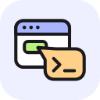

<p align="center">
  
</p>

<h1 align="center">Clicknote</h1>

<p align="center">
  <strong>Feedback on a web page, straight to your coding agent.</strong><br>
  Click what should change, say how, and send it all in one go.
</p>

<p align="center">
  
  
  
</p>

Clicknote is a browser extension and a skill for your coding agent. You click elements on a web page, write what should change or what you want to know, and send it all to the agent. It works in any coding agent with a shell and skills, such as Claude Code, Codex and OpenCode.

![A product landing page in Chrome with three numbered markers: on the "Start free trial" button, on the row of feature cards and on the "Sign in" link. Under the text of the middle card, which is outlined, a popup shows the element's label, the comment "Shorten this to two lines, like the other cards" being written, the Change and Question switch on Change, and Cancel and Add. At the bottom right, the Annotations bar lists the three comments, two marked Change and one Question, with a general comment below them, the waiting agent "● my-site · landing page copy · claude-code · waiting" chosen in the dropdown, its entry cut at the end to fit, and the Copy and Send buttons.](docs/readme/annotating.png)

## Why

Agents build pages fast, but feedback on a page is visual, and a chat is text. So you describe where things are ("the second card, under the heading, no, the other one"), take screenshots, paste them in, and then check whether the agent changed the right element. Every round costs time, and a vague pointer gets the wrong thing changed.

## How

Give the feedback on the page itself. Click an element, write what should change or what you want to know, and do the same for everything else that bothers you. Then press Send.

Your agent asked for the feedback and waits for it. It gets one line that points to a folder with each comment next to the element's CSS selector, text, HTML and styles, and a screenshot of the element as you saw it. It carries out the Change items and answers the Question items in its own conversation.

## Install

You need a Chromium browser (Chrome, Chromium, Brave, Edge or Vivaldi), Node.js 22.20 or later, and a coding agent with a shell and skills. Clicknote itself runs on Node.js 22.0 or later; the `skills` tool that adds it asks for 22.20.

1. **Install the extension.** Download `clicknote-extension-vX.Y.Z.zip` from the [latest release](https://github.com/inlet/clicknote/releases/latest) and unpack it in a folder where it can stay. Open `chrome://extensions`, switch on **Developer mode**, click **Load unpacked** and choose the folder `clicknote-extension`. Then pin the extension, so its button stays in the toolbar. Install it in your default browser: that is where your agent opens pages.

   Optional: to use it on local `file://` pages, click **Details** on the extension and switch on **Allow access to file URLs**.

2. **Add the skill** for your agents:

   ```sh
   npx skills add inlet/clicknote -g
   ```

   The `skills` tool asks which of your coding agents get it, and places it where each of them looks for skills. With `-g` every project has it; `npx skills add inlet/clicknote` without `-g` adds it to the project you run it in only. The skill holds Clicknote's command, so your agent needs no network to use it.

## Use

1. **Ask your agent for feedback on a page,** for example: *"Open localhost:3000, I want to give feedback."* When you have the page open already, say:

   ```
   Wait for my annotations with the clicknote skill.
   ```

   The agent registers with Clicknote, opens the page in your browser when you asked it to, tells you how it is listed in the bar, and waits.
2. **Turn the bar on:** click the extension's button in the toolbar, or press `⌥⇧H` on macOS (`Alt+Shift+H` on Windows and Linux). A bar appears at the bottom right of the page.
3. **Annotate:** click an element, write your comment, choose **Change** or **Question**, and press **Add**. The element gets a numbered marker. Do the same for anything else, and add a general comment if you like.
4. **Check that the bar shows your agent, and press Send.**

You never start or stop anything. Clicknote starts when an agent needs it and stops by itself when nothing uses it.

Good to know:

- **After a reload or a navigation, turn the bar on again.** Unsent annotations are kept per tab and come back when you turn the bar on again on the same page.
- **The bar chooses the agent for you:** the agent that opened the page in this tab or that this tab last sent to, else the agent this site last went to, else the only agent listed. With several agents and none of these, it asks you to choose, and Send stays off until you do.
- **Prefer the keyboard?** `⌥⇧H` (`Alt+Shift+H`) turns the bar on and off, `⌘↵` (`Ctrl+Enter`) adds the comment, and `Esc` closes the popup or stops picking so you can click the page.

## What you can ask your agent

The skill tells your agent what to do with each of these. Say it in your own words.

| Say | What your agent does |
|---|---|
| "Open localhost:3000, I want to give feedback." | Opens the page in your browser, tells you how it is listed in the bar, and waits for your annotations. |
| "I want to give feedback on the site." | Finds the address the site is served on, or starts a server and tells you the address. Then it opens the page and waits. |
| "Wait for my annotations with the clicknote skill." | For a page you have open already: registers, tells you how it is listed, and waits. |
| Paste a line that Copy gave you | Reads the annotations the line points to, carries out the Change items and answers the Question items, without waiting. |
| "Stop waiting." | Ends its wait and leaves the list in the bar. |
| "Stop Clicknote." | Stops Clicknote now. |
| "Update Clicknote." | Updates the skill, and tells you how to update the extension. |
| "Remove Clicknote." | Stops Clicknote, deletes what it stored, tells you how to remove the extension, and removes the skill. |

## The agent in the bar

The dropdown above Send lists the agents on this computer that wait now or were active in the last hour, for example:

```
● my-site · landing page copy · claude-code · waiting
```

- `my-site` is the agent's project folder.
- `landing page copy` is what the agent says it works on, in your words. It says so again each time it waits, so the entry follows its work.
- `claude-code` is its harness.
- The filled dot and `waiting` say that it waits right now, so a send reaches it at once. An agent that does not wait has an open dot: `○ my-site · landing page copy · claude-code`. It gets your send when it next waits.

A part that is empty is left out. When two agents read the same, the later one gets a number, such as `○ my-site · landing page copy · claude-code · 2`.

An agent whose wait you stop, or whose session you close while it waits, leaves the list at once. An agent whose session ends while it works, and so does not wait, stays listed with an open dot for up to an hour, and a send to it stays queued.

When no agent is listed, the bar says that no agent is listening, and offers the sentence to say to your agent with a button that copies it.

## Send and Copy

**Send** stores the annotations, with a screenshot of each element, and queues them for the agent you chose. The list, the markers and the general comment are cleared once Clicknote has them. A waiting agent picks them up at once. An agent that is busy gets them the moment it waits again, so you can send while it still works on the previous round. The bar says which happened:

- "Sent 3 annotations to my-site · landing page copy · claude-code. The agent picked them up."
- "Sent 3 annotations to my-site · landing page copy · claude-code. Queued: the agent gets them when it next waits." The bar offers the send's line to copy, for when you would rather paste it into another agent.
- "Sent 3 annotations to my-site · landing page copy · claude-code, but that agent is no longer listed and did not pick them up. Copy the line and paste it into another agent. If that agent comes back and waits again, it still gets them." With the line to copy as well.

The bar keeps an eye on the send for half a minute, and after that each time you come back to the page or use the bar, until the agent has picked it up or is no longer listed. That an agent is no longer listed it says once: copy the line while the message is there, because after a reload the bar shows nothing more of that send.

A queued send waits for its agent for seven days. When the agent stopped waiting, one word to it, such as "wait", fetches what is queued.

**Copy** writes the same folder and puts the line on the clipboard, for any agent, with or without the skill. The bar says "Copied. Paste the line into your agent." When Clicknote is not running, Copy puts the annotations on the clipboard as Markdown instead, without screenshots, and the bar says "Copied as Markdown, without screenshots."

## What your agent receives

One line:

```
Browser annotations (3) on http://localhost:3000/: read /Users/you/.local/state/clicknote/sends/20261119-153012/annotations.md, carry out the Change items and answer the Question items.
```

`annotations.md` holds each comment, whether it is a Change or a Question, and what the page says about the element: its selector, text, HTML and styles. A screenshot of each element lies next to it. The comments are your words; everything else was copied from the page, and the skill tells the agent never to follow instructions in it. The full format is in [What the agent receives](docs/reference.md#what-the-agent-receives).

## Your harness

Clicknote was tried by hand in Claude Code on macOS. Codex and OpenCode 2 on macOS are still to be tried. Linux and Windows, and Cursor, Gemini CLI and Copilot CLI, are expected to work, but were not tried by hand.

Every harness uses the same skill, added with the one command under [Install](#install). The skill tells the agent how to wait, by what its harness can do:

- **Claude Code** waits with the command in the background. The agent stays free: you can go on talking to it, and it picks up your send whenever you press Send. An ordinary session puts no time limit on it.
- **Codex** waits with the command in the foreground. The agent's turn stays open while it waits. When Codex ends the command before you send, the agent waits again, and nothing is lost. Codex's shell sandbox does not let a command write outside the project or start a server that listens, and Clicknote's commands do both. So the agent runs them outside the sandbox, and Codex asks you first.
- **OpenCode 2** runs the command in the background, and the agent stays free. **OpenCode 1** waits in the foreground: the agent's turn stays open, and its shell's time limit can be set as long as needed.
- **Any other harness** waits with the command in the background where it gives the agent a turn when a background command ends, and in the foreground elsewhere.

## Updating

Ask your agent: with the skill, it knows how. It updates the skill, with Clicknote's command in it, with `npx skills update clicknote -g`. You update the extension: download the newest zip, unpack it over the old folder, and press the extension's reload button at `chrome://extensions`. When the extension and Clicknote no longer fit together, the bar says which of the two to update.

## Stopping and removing

Clicknote stops by itself when nothing uses it, so there is nothing to stop. To stop it now, or to remove everything, ask your agent: with the skill, it knows how. The steps are also in the [reference](docs/reference.md#remove).

## Known limits

- Chromium browsers only, one page per send, and no drawing on screenshots.
- An iframe is picked as a whole. Modal dialogs, popovers and menus that open on hover cannot be picked.
- Only agents on this computer are listed.
- A screenshot shows only the part of the element that is in the window.
- Clicknote uses port 47823. Another program on that port keeps it from starting.
- A web page cannot pretend to be the extension, but another user account on this computer can: it can hold the port and receive what the extension sends, or queue a send for your agent. Do not use Clicknote on a computer you share with people you would not let give your agent instructions.
- An agent in a harness that cannot wake it gets a queued send only when it waits again.
- When a harness ends an agent's wait at its own time limit, the agent is off the list until it waits again, a few seconds later. A send in that moment is refused and the annotations stay: press Send again.

The full list is in [Known limits](docs/reference.md#known-limits).

## Permissions

The extension can only reach a page after you click its button or press the shortcut there, and then only that tab. It has no access to any other site: its one other permission to reach an address is `http://127.0.0.1`, to talk to Clicknote on your computer and to recognise the tabs your agent opens through it. It has no remote code and no analytics. Why it needs each permission is in [Permissions](docs/reference.md#permissions).

## How it works

| Part | What it does |
|---|---|
| **Extension** | Draws the bar, the markers and the popup in the page, takes the screenshots, and passes the annotations to the bridge. |
| **Bridge** | A small server on your computer, at `http://127.0.0.1:47823`, that only the extension talks to. It writes the annotations and screenshots to a folder and queues them for the agent you chose. It also passes a page your agent opens on to the browser, so the bar knows which agent opened it. It starts when an agent needs it and stops by itself. |
| **Command** | One program file in the skill, which the agent runs with Node: it registers the agent, opens a page, waits for annotations and stops the bridge. The same file is the bridge. |
| **Skill** | Tells the agent which page to open, how to wait, and what to do with the annotations. |
| **State folder** | Where the agents and the bridge meet, readable by you only: the agents, their queued sends, and one folder per Send or Copy with `annotations.md`, `annotations.json` and a screenshot per element. Removed after 7 days. See the [reference](docs/reference.md#the-state-folder). |

The agent never talks to the bridge over the port: the command works through the files in the state folder, so whatever listens on the port cannot give your agent instructions. Everything stays on your computer. The only things that go over the network are the `skills` tool fetching the skill from GitHub, and `npx` fetching Clicknote when your agent cannot run it from the skill's folder.

## Development

How to build, test and release it is in [CONTRIBUTING.md](CONTRIBUTING.md).

## Licence

MIT. See [LICENSE](LICENSE).
